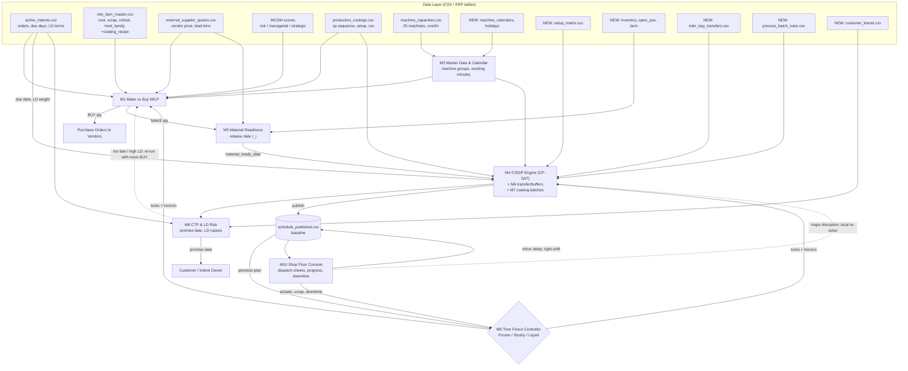
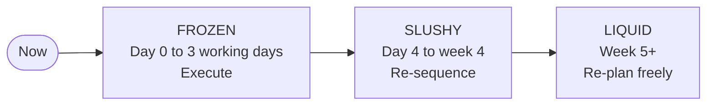

# Integrated Planning & Scheduling: Modules, Input Variables, Data Flow & Time Fences

> [!IMPORTANT]
> **Correction to earlier slides:** `production_routings.csv` already uses numbered machines (`CNC_MILL_3`, `LENS_POLISHER_5`, …), and there are **25 machines in 5 groups of 5**. The real gap is that **each routing step is pinned to one specific machine**. The scheduler cannot move a job to an idle sister machine. The fix (Module M4) is the same as before. Only the wording of the gap changes.

---

## 1. Module Catalogue

| # | Module | Status | Planning Horizon | One-line Purpose |
| :-- | :-- | :-- | :-- | :-- |
| M1 | Make vs Buy Optimizer (MILP) | ✅ Exists (`app.py` L76–216) | Liquid | Decide MAKE / BUY / SPLIT per order |
| M2 | Baseline Job Shop Scheduler (CP-SAT) | ✅ Exists (`app.py` L259–403) | Slushy | Sequence in-house ops, fixed machine |
| M3 | Master Data & Calendar Manager | 🆕 New | All | Single source for machines, shifts, holidays, groups |
| M4 | Flexible Job Shop Engine (FJSSP + SDST) | 🆕 New (replaces M2) | Slushy | Parallel-machine routing + changeover matrix |
| M5 | Material Readiness & MRP-lite | 🆕 New | Liquid → Slushy | Earliest release date per order from stock and vendor POs |
| M6 | Inter-Bay Transfer & Buffer Module | 🆕 New | Slushy | Cart move times τ and staging-rack limits |
| M7 | ~~Coating Batching~~ & Time-Lag Module | ⛔ Batching not needed (user: chambers run one order at a time). Only cooling/curing time lags remain, optional | Slushy | Cooling/curing windows only |
| M8 | Delivery Promising (CTP) & LD Risk | 🆕 New | Liquid | Realistic promise date + liquidated-damages exposure |
| M9 | Time Fence Controller (Frozen / Slushy / Liquid) | 🆕 New | All | Locks, partial locks, free zones for every run |
| M10 | Shop Floor Execution & Disruption Console | 🆕 New | Frozen | Dispatch sheets, progress logging, right-shift / re-solve |

---

## 2. Input Variable Inventory per Module

Legend: ✅ **Present** (exact file.column) · 🔁 **Derivable** (calculated from existing data, nothing new to collect) · 🆕 **New** (must be collected)

### M1 — Make vs Buy Optimizer (exists)
| Variable | Status | Source |
| :-- | :-- | :-- |
| Order qty, delivery days | ✅ | `active_indents.order_quantity`, `delivery_period_days` |
| Raw material cost, scrap %, labour cost, critical flag | ✅ | `mto_item_master.*` |
| Vendor price, lead time, reliability, IQA hrs/cost | ✅ | `external_supplier_quotes.*` |
| Risk / managerial / strategic scores | ✅ | `sourcing_risk_data`, `managerial_performance_data`, `strategic_performance_data` |
| Machine hours, WIP, cost/hr | ✅ | `machine_capacities.*` |
| **LD rate & cap, contract value** | ✅ present but **unused** | `active_indents.ld_rate_per_week`, `max_ld_percentage`, `contract_value_per_unit` |
| Vendor reliability in objective | ✅ present but **unused** | `external_supplier_quotes.vendor_reliability_score` |
| Capacity limited to the planning horizon (not yearly) | 🔁 | `available_yearly_hours × horizon/52` from M3 calendar |

### M3 — Master Data & Calendar Manager
| Variable | Status | Source / Note |
| :-- | :-- | :-- |
| `machine_id`, cost/hr | ✅ | `machine_capacities` |
| `machine_group` (CNC_MILL, LENS_POLISHER, COATING_CHAMBER, ASSEMBLY_STATION, TESTING_RIG) | 🔁 | Remove the `_2.._5` suffix from `machine_id` |
| Working pattern 8:00–18:00, Mon–Sat | 🔁 | Hard-coded today in `map_to_real_schedule()`. Move it to config |
| Shift pattern per machine (1/2/3 shifts) | 🆕 | `machine_calendars.csv` |
| Plant holidays | 🆕 | `plant_holidays.csv` |
| Planned maintenance windows | 🆕 | `machine_calendars.csv` |
| Machine status (active / down / retired) | 🆕 | Supervisor-maintained flag |
| Operator count per group per shift | 🆕 | `operator_roster.csv` (optional, phase 2) |

### M4 — Flexible Job Shop Engine (FJSSP + SDST)
| Variable | Status | Source / Note |
| :-- | :-- | :-- |
| Operation sequence, setup hrs, run hrs/unit | ✅ | `production_routings.*` |
| In-house qty per order | ✅ | `Final_Make_Buy_Decisions.Make_In_House_Qty` |
| Due date | ✅ | `delivery_period_days` (relative days) |
| Eligible machine set per operation | 🔁 | Default = all machines in the same `machine_group`. Override with 🆕 `eligible_machines` column if some machines cannot run some items |
| Machine speed factor (older machine slower) | 🆕 | `machine_capacities.speed_factor` (default 1.0) |
| Item family / tooling family | 🆕 | `mto_item_master.tool_family` |
| Changeover matrix `from_family → to_family` hrs | 🆕 | `setup_matrix.csv`. Until it exists, use routing `setup_hours` as a uniform setup |
| Tardiness weight per order | 🔁 | `contract_value_per_unit × qty × ld_rate_per_week`, capped by `max_ld_percentage` |
| Absolute order date / due date | 🆕 | `active_indents.order_date` (today only relative days exist) |

### M5 — Material Readiness & MRP-lite
| Variable | Status | Source / Note |
| :-- | :-- | :-- |
| Raw material cost | ✅ | `mto_item_master.raw_material_cost_per_unit` |
| Gross requirement incl. scrap | 🔁 | `qty × (1 + expected_scrap_percentage)` |
| Buy-side arrival date | 🔁 | `order_date + vendor_lead_time_days + incoming_qa_hours` |
| BOM (component, qty per parent) | 🆕 | `bom.csv` (if items have sub-components) |
| On-hand stock per material | 🆕 | `inventory.csv` |
| Open purchase orders + ETA | 🆕 | `open_pos.csv` |
| Raw material procurement lead time | 🆕 | `mto_item_master.rm_lead_time_days` |
| **Output →** `material_ready_date` per order = earliest start (`release date r_i`) for M4 | 🔁 | |

### M6 — Inter-Bay Transfer & Buffer (manual carts, no AGV)
| Variable | Status | Source / Note |
| :-- | :-- | :-- |
| Group-to-group transfer minutes τ | 🆕 | `inter_bay_transfers.csv` (5×5 matrix, e.g. 5 min same bay, 15–30 min cross-bay) |
| Staging-rack capacity per group (carts / lots) | 🆕 | `inter_bay_transfers.csv.buffer_capacity` |
| Transfer lot size (full order vs partial lots) | 🆕 | Policy flag. Default = full order |

### M7 — Coating Batching & Time-Lag
| Variable | Status | Source / Note |
| :-- | :-- | :-- |
| Coating chamber machines | ✅ | `COATING_CHAMBER`, `_2.._5` |
| Coating recipe per item (which items may share a chamber run) | 🆕 | `mto_item_master.coating_recipe` |
| Chamber min / max load (units) | 🆕 | `process_batch_rules.csv` |
| Cycle time per batch (fixed, not per unit) | 🆕 | `process_batch_rules.csv`. Today `run_hours_per_unit` treats coating as per unit |
| Min / max wait after coating (θmin, θmax) | 🆕 | `process_batch_rules.csv` |

### M8 — Delivery Promising (CTP) & LD Risk
| Variable | Status | Source / Note |
| :-- | :-- | :-- |
| LD rate, LD cap, contract value | ✅ | `active_indents.*` |
| Vendor lead time | ✅ | `external_supplier_quotes.vendor_lead_time_days` |
| Planned completion per order | 🔁 | Output of M4 |
| Projected LD ₹ per order | 🔁 | `min(weeks_late × ld_rate, max_ld) × contract_value × qty` |
| Dispatch / packing / transit days to customer (COD Agra etc.) | 🆕 | `customer_transit.csv` |
| Inspection / acceptance lead time (customer QA) | 🆕 | Per customer |

### M9 — Time Fence Controller
| Variable | Status | Source / Note |
| :-- | :-- | :-- |
| Frozen fence length (days) | 🆕 | Config, suggested **3 working days** |
| Slushy fence length (days) | 🆕 | Config, suggested **4 weeks** |
| Plan run timestamp ("now") | 🔁 | System clock |
| Previous published schedule | 🔁 | Saved by M10 (`schedule_published.csv`) |
| Override log (who unlocked what, why) | 🆕 | `fence_overrides.csv` |

### M10 — Shop Floor Execution & Disruption Console
| Variable | Status | Source / Note |
| :-- | :-- | :-- |
| Published schedule | 🔁 | From M4 |
| Operation status (not started / setup / running / done) | 🆕 | Supervisor entry or barcode scan per shift |
| Actual start / finish, good qty, scrap qty | 🆕 | Shift report |
| Machine downtime events (machine, from, to, reason) | 🆕 | Supervisor entry |
| Rush order insert | 🆕 | Supervisor entry → M1/M4 |
| Safety buffer % per machine group | 🆕 | Config, default 5–10 % |

### Summary Count
| Category | Count |
| :-- | :-- |
| ✅ Present and already used | ~30 columns across 9 CSVs |
| ✅ Present but **unused** (quick wins) | 4 (`ld_rate_per_week`, `max_ld_percentage`, `contract_value_per_unit`, `vendor_reliability_score`) |
| 🔁 Derivable (no data collection needed) | 12 |
| 🆕 New (must be collected) | ~25 fields in ~9 new small files |

**Minimum new data to start M4 (Phase 1):** `order_date` and nothing else. Machine groups come from the machine names, and setups can stay uniform at first.

---

## 3. Integrated System Flowchart & Data Flow



### Data Contracts Between Modules
| From → To | File / Object | Key Fields |
| :-- | :-- | :-- |
| M3 → M1, M4 | `calendar` object | `machine_id, machine_group, working_windows[], down_windows[]` |
| M1 → M5 / Purchasing | `Final_Make_Buy_Decisions.csv` (exists) | `Order_ID, Item_ID, Make_In_House_Qty, Buy_External_Qty` |
| M5 → M4 | `order_release.csv` | `Order_ID, material_ready_date, shortage_flag` |
| M9 → M4 | `fence_state` | `frozen_ops[] (fixed start + machine), slushy_ops[] (fixed machine group), liquid_ops[]` |
| M4 → M8, PUB | `schedule_published.csv` | `Order_ID, op_seq, machine_id, start, end, setup_min, batch_id, version` |
| M8 → Customer / M1 | `promise_report.csv` | `Order_ID, promise_date, days_late, projected_LD_rs` |
| M10 → M9 | `shop_actuals.csv`, `downtime_log.csv` | `op_id, status, actual_start, actual_end, good_qty, scrap_qty` / `machine_id, from, to, reason` |

---

## 4. Frozen / Slushy / Liquid: How Each Zone Is Managed



### 4.1 Zone Rules (What Each Module May Change)
| Decision | ❄️ Frozen (0–3 days) | 🧊 Slushy (4 days – 4 wks) | 💧 Liquid (> 4 wks) |
| :-- | :-- | :-- | :-- |
| Make vs Buy (M1) | Locked | Locked (BUY POs already placed) | **Free** |
| Order quantity | Locked | Locked | Free |
| Machine group | Locked | Locked | Free |
| Specific machine (e.g. CNC_MILL_3 vs _4) | Locked | **Free within group** | Free |
| Sequence on machine | Locked | **Free** (SDST clustering) | Free |
| Start time | Locked (right-shift only) | Free | Free |
| Coating batch membership | Locked | Free (until chamber loaded) | Free |
| Purchase orders | Executing | Expedite only | Plan / place |
| Who can change | Supervisor override + reason | Planner (re-run M4) | Automatic nightly run |

### 4.2 How It Is Enforced in the Solver (M9 → M4)
For every operation in the previous published schedule, M9 tags its zone using its **planned start** relative to `now`:

| Zone | CP-SAT Treatment |
| :-- | :-- |
| ❄️ Frozen | `start == previous_start` (or `≥` if right-shifted), machine presence literal fixed to the previous machine. Operations already **done** are removed. **In-progress** ones keep their remaining duration from `now` |
| 🧊 Slushy | Machine literal limited to the same group. Start is free. A soft penalty `ε·|start − previous_start|` limits nervousness |
| 💧 Liquid | No restrictions. M1 may also re-decide MAKE/BUY for these orders |

```text
for op in previous_schedule:
    zone = frozen if op.start < now + FROZEN_DAYS
           slushy if op.start < now + SLUSHY_DAYS
           liquid otherwise
    if op.status == DONE:          skip
    elif zone == frozen:           fix machine; fix start (allow right-shift only)
    elif zone == slushy:           restrict to op.machine_group; add stability penalty
    else:                          free
```

### 4.3 Operating Rhythm (No IoT, Human-in-the-Loop)
| Cadence | Trigger | Action | Zones Touched |
| :-- | :-- | :-- | :-- |
| **End of every shift** | Supervisor enters actuals in M10 | Mark ops done / in progress, log scrap & downtime | Frozen state updated |
| **Minor delay (< safety buffer)** | Logged delay | Absorbed by the 5–10 % buffer. No change | — |
| **Delay > buffer** | Supervisor clicks *Right-Shift* | Push successors on the same machine and route. No re-sequencing | Frozen + slushy start times |
| **Machine down > 1 shift** | Supervisor marks machine down | Frozen ops on that machine are unlocked (override logged). Local re-solve moves them to sister machines | Frozen (override) + slushy |
| **Daily, e.g. 06:00** | Scheduled job | M5 refresh → M4 re-solve slushy + liquid → publish → print dispatch sheets | Slushy + liquid |
| **Weekly** | Planner | M1 re-run for liquid orders, M8 promise report, LD review | Liquid |
| **Rush order** | Supervisor / planner | Insert into slushy with high weight. Frozen untouched unless overridden | Slushy |

### 4.4 Governance
- **Override log:** every unlock inside the frozen fence records user, time, reason, and affected ops (`fence_overrides.csv`).
- **Nervousness KPI:** % of slushy ops that changed machine or moved more than 4 h between two published versions. Target < 15 %.
- **Plan adherence KPI:** % of frozen ops started within ±1 shift of plan. A low value means the fences or buffers need tuning.

---

## 5. Recommended Build Order
1. **M3 + M4 (FJSSP)**: needs only `order_date`. This gives the largest makespan gain.
2. **M9 + M10**: time fences, published baseline, dispatch sheets, right-shift. Makes the plan usable on the floor.
3. **M8**: uses the LD columns that are already present. Quick win for delivery promising.
4. **M5**: needs inventory and PO data.
5. **M6, M7**: need floor measurements (cart times, chamber loads).

## 6. Data I Need From You
1. Does each order have an **order/indent date**? (Needed to turn `delivery_period_days` into calendar dates.)
2. Can **every machine in a group** run every item of that group, or are some restricted?
3. Is a **3-day frozen / 4-week slushy** fence realistic for your shop?
4. Do coating chambers actually **batch** multiple orders together?
