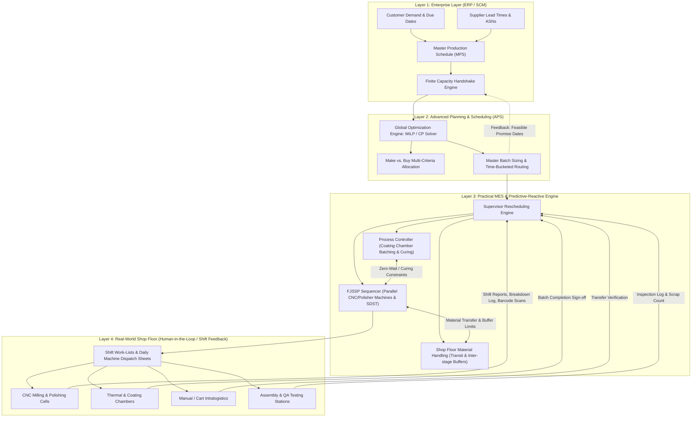

# Whole-Factory Optimal Process Scheduling: Comprehensive Architecture, Mathematical Formulations & Implementation Roadmap

---

## Executive Summary

Modern industrial scheduling cannot be treated as an isolated single-machine or purely discrete problem. As established in manufacturing operations research and the ISA-95 standard hierarchy, isolated optimization creates severe sub-optimal traps—such as high-speed CNC centers starving for raw stock due to material-handling bottlenecks, or downstream packaging lines choking because upstream chemical/thermal batch operations finished out of sync.

This report provides a **holistic engineering and algorithmic roadmap** to transform the existing codebase from a two-stage disjoint prototype (order-level Make vs. Buy MILP + naive single-machine CP-SAT Job Shop) into a **unified Cyber-Physical Integrated Planning and Scheduling (IPS) System**.

The target framework bridges:
1. **Process/Batch Scheduling (STN/RTN)** for upstream batch, coating, and thermal stages.
2. **Flexible Job Shop Scheduling (FJSSP)** with parallel machines, sequence-dependent setups, and auxiliary tooling/operator constraints.
3. **Inter-Bay Material Handling & Workstation Buffering** accounting for manual cart/trolley transfer times ($\tau_{ab}$) and finite intermediate buffers (FIS / Blocking Job Shop) without requiring automated AGVs/AMRs.
4. **Closed-Loop Digital Twin & Event-Driven Rescheduling** leveraging Right-Shift Repair, Local Search, and Deep Reinforcement Learning (DRL) for dynamic disruptions.

---

## 1. System Blueprint & The 4-Layer ISA-95 Architecture



1. **ERP $\leftrightarrow$ APS (The Capacity Handshake):**
   - **The Problem:** Standard ERPs assume infinite machine capacity with fixed lead-time offsets, creating unrealizable shop schedules.
   - **The Mechanism:** APS ingests ERP work orders, runs finite-capacity mathematical programming, and feeds back mathematically certified completion dates.
2. **Process Batching $\leftrightarrow$ Discrete Job Shop (The Temporal Handshake):**
   - **The Problem:** Upstream batch processes (e.g., optical vacuum coating, chemical batching, autoclave curing) have **Zero-Wait (ZW)** or **Limited-Wait (LW)** characteristics ($\theta_{\min} \le t_{\text{gap}} \le \theta_{\max}$). Parts cool, oxidize, or settle if not transferred immediately.
   - **The Mechanism:** Downstream discrete operations (milling, assembly, lens polishing) are locked backwards from upstream batch completion timestamps.
3. **Job Shop Sequencer $\leftrightarrow$ Material Handling (The Handshake):**
   - **The Problem:** An operation $O_{i,j+1}$ cannot start the instant $O_{ij}$ finishes on machine $M_a$. It requires deburring/washing, packaging into tote bins, manual cart transit to the next bay, and fixture preparation.
   - **The Mechanism:** When $O_{ij}$ completes on machine $M_a$, an inter-bay transfer lag $\tau_{ab}$ is applied. If the staging buffer at downstream machine $M_b$ is full (Finite Intermediate Storage, FIS), machine $M_a$ cannot release the lot, preventing floor aisle congestion.

---

## 2. Comprehensive Taxonomy of Required Input Variables

To implement a full factory scheduling system, the input domain is structured into five distinct mathematical classes. The table below contrasts the **current repository data** against the **required target schema**:

| Variable Class | Parameter / Symbol | Physical Meaning & Description | Current Code Status | Required Target Schema |
| :--- | :--- | :--- | :--- | :--- |
| **A. Demand & Routing** | $J_i, w_i$ | Job identifier and tardiness weight/penalty ($/hr) | Present in `active_indents.csv` | Extend with customer tier weighting |
| | $r_i, d_i$ | Earliest material release date and committed due date | Delivery days present | Exact timestamp calendars (ISO 8601) |
| | $G = (V, E)$ | Directed Acyclic Graph (DAG) Bill of Materials & precedence | Linear sequence only (`production_routings.csv`) | Multi-branch assembly DAG trees |
| | $O_{ij}, M_{ij}$ | Eligible machine set for operation $j$ of job $i$ | Single machine fixed per operation | **FJSSP Flexible Machine Sets** (e.g., `[CNC_MILL, CNC_MILL_2..5]`) |
| | $[B_{\min}, B_{\max}]$ | Batch sizing bounds for batching/chamber operations | Missing | Min/max volume limits for coating/curing |
| **B. Resource & Machine** | $p_{ijk}$ | Processing time of operation $O_{ij}$ on machine $k$ | Fixed run hours | Matrix of times across eligible machine alternatives |
| | $s_{k, ij, i'j'}$ | **Sequence-Dependent Setup Time (SDST)** matrix | Static setup hours | Matrix $S_{k, A, B}$ for changeovers, cleaning, tooling swaps |
| | $[t_{\text{start}}, t_{\text{end}}]$ | Shift calendars and planned preventive maintenance windows | Generic 10h Mon-Sat | Machine-specific shift calendars & maintenance schedules |
| | MTBF / MTTR | Mean Time Between Failures and Mean Time To Repair | Missing | Weibull/Exponential distributions for dynamic simulation |
| | Auxiliary Resources | Specialized fixtures, optical test rigs, operator certifications | Missing | Secondary resource capacity intervals |
| | $E_{ijk}$ | Power consumption per state (Idle, Warm-up, Processing) | Missing | TOU electricity tariffs & peak power limits |
| **C. Buffer & Flow Rules** | Buffer Policy | UIS (Unlimited), FIS (Finite), NIS/ZW (Zero-Wait) | Assumed UIS (Infinite) | Explicit buffer capacities $C_b$ per machine cell |
| | $\theta_{\min}, \theta_{\max}$ | Minimum curing/cooling time and maximum perishability | Missing | Time-lag constraints between consecutive operations |
| | Re-entrant Flags | Workpiece re-visiting the same machine group | Missing | Cyclic route indexing |
| **D. Material Handling & Buffers** | $\tau_{ab}$ | Inter-bay transfer time matrix between machine groups | Missing | Standard matrix of transfer times between departments (e.g., 10–30 mins) |
| | $C_b$ | Workstation buffer / staging rack capacity | Missing | Max tote bins or carts that can queue at machine $b$ before blocking |
| | Transfer Lot Size | Minimum/maximum transfer batch size between bays | Missing | Number of units moved per trolley trip |
| **E. Multi-Objective Weights** | $\alpha, \beta, \gamma, \delta, \epsilon$ | Cost coefficients for Makespan, Tardiness, Energy, WIP, Nervousness | Makespan or Tardiness only | Unified Pareto multi-objective scalarization |

---

## 3. Mathematical Formulation of the Unified Whole-Factory Model

The whole-factory optimization problem is formulated using **Constraint Programming with Interval Variables (CP-SAT)**, proven in operations research literature (Laborie et al., 2018; Schlenkrich & Parragh, 2023) to outperform standard MILP by multiple orders of magnitude for complex industrial scheduling.

### 3.1 Objective Function

$$\min \quad \mathcal{F} = \alpha \cdot C_{\max} + \beta \sum_{i \in \mathcal{J}} w_i \cdot T_i + \gamma \cdot TEC + \delta \sum_{i \in \mathcal{J}} WIP_i + \epsilon \cdot \Delta_{\text{nervousness}}$$

Where:
- $C_{\max} \ge \text{End}(O_{i, \text{last}}) \quad \forall i \in \mathcal{J}$ (Factory Makespan).
- $T_i = \max(0, \text{End}(O_{i, \text{last}}) - d_i)$ (Order Tardiness).
- $TEC = \sum_{k} \left( E_{\text{proc}, k} + E_{\text{idle}, k} \right)$ (Total Machine Energy Consumption).
- $WIP_i = \text{End}(O_{i, \text{last}}) - \text{Start}(O_{i, 1})$ (Work-in-Process flow time).
- $\Delta_{\text{nervousness}} = \sum |\text{Start}_{\text{repaired}} - \text{Start}_{\text{baseline}}|$ (Schedule stability during dynamic disruption).

---

### 3.2 Constraint Sets

#### 1. Flexible Machine Allocation (Alternative Intervals)
For each operation $O_{ij}$, let $\mathcal{M}_{ij}$ be the set of capable parallel machines:
$$\sum_{k \in \mathcal{M}_{ij}} x_{ijk} = 1 \quad \forall i, j$$
Where $x_{ijk} \in \{0, 1\}$ is a Boolean variable indicating whether operation $O_{ij}$ is assigned to machine $k$. In CP-SAT, this is modeled with optional interval variables:
$$\text{Presence}(I_{ijk}) = x_{ijk}, \quad \text{Span}(I_{ij}, [I_{ijk} \mid k \in \mathcal{M}_{ij}])$$

#### 2. Sequence-Dependent Setup Time (SDST) & Machine Disjunctive Constraints
On any machine $k$, operations cannot overlap, and transition between consecutive operations $O_{a} \to O_{b}$ requires sequence-dependent setup time $s_{k, a, b}$:
$$\text{Start}(I_{b}) \ge \text{End}(I_{a}) + s_{k, a, b} \quad \text{if } O_a \text{ directly precedes } O_b \text{ on machine } k$$
In CP-SAT, this is formulated via `AddCircuit` or `AddNoOverlap` with transition matrices.

#### 3. Material Handling & Inter-Bay Transfer Delays (Manual Carts / Trolleys)
Since the factory uses manual material handlers and shop floor trolleys rather than automated AGVs/AMRs, transfer between consecutive stages is modeled via an inter-bay transfer matrix $\tau_{ab}$:
$$\text{Start}(O_{i, j+1}) \ge \text{End}(O_{ij}) + \tau_{ab}$$
Where $\tau_{ab}$ represents the handling time required to deburr/wash, load into tote boxes/bins, transport the cart to bay $b$, and stage the parts at the machine:
$$\tau_{ab} = \begin{cases} 
0 & \text{if } M_a = M_b \text{ (same workstation)} \\
t_{\text{intrabay}} & \text{if } M_a, M_b \text{ in same department (e.g. 5–10 mins)} \\
t_{\text{interbay}} & \text{if } M_a, M_b \text{ across different departments (e.g. 15–30 mins)}
\end{cases}$$

#### 4. Finite Intermediate Storage (FIS) & Blocking Conditions
If the downstream buffer at machine $M_b$ has capacity $C_b$ and is full, workpiece $O_{ij}$ cannot leave machine $M_a$. Thus, $M_a$ remains blocked:
$$\text{ReleaseTime}(M_a, O_{ij}) = \text{EntryTime}(\text{Buffer}_b, O_{ij})$$
$$\text{BufferOccupancy}_b(t) \le C_b \quad \forall t$$

#### 5. Upstream Process Batching & Zero-Wait (ZW) / Limited-Wait (LW)
For thermal/coating processes requiring immediate downstream processing or strict time lags:
$$\theta_{\min} \le \text{Start}(O_{i, j+1}) - \text{End}(O_{ij}) \le \theta_{\max}$$

---

## 4. Codebase Audit: Current State vs. Target Evolution

### 4.1 What Exists in the Codebase Today
1. **Make vs. Buy MILP (`app.py`, lines 78–217):**
   - Solves order splitting using PuLP.
   - Calculates aggregate machine hours against yearly capacity (`available_yearly_hours - existing_wip_hours`).
   - Ignores machine scheduling, changeovers, queues, and intralogistics entirely.
2. **Job Shop CP-SAT Module (`app.py`, lines 259–404 and `schedule_makespan.py`):**
   - Filters `Make_In_House_Qty > 0`.
   - Simple JSSP with strictly sequential operations per item.
   - Uses only a single hard-coded machine per operation (`CNC_MILL`, `LENS_POLISHER`, etc.), completely ignoring the 19 parallel machines available in `machine_capacities.csv` (`CNC_MILL_2..5`, `LENS_POLISHER_2..5`, etc.).
   - Zero sequence-dependent setups, zero transfer transit times, infinite buffers.
   - Fixed calendar projection using a simplistic modulo calculation (10h/day, 6 days/week).

### 4.2 Gap Matrix & Evolution Path

```
Current State                               Target Whole-Factory Architecture
┌───────────────────────────┐               ┌──────────────────────────────────────────────┐
│ Make/Buy (Aggregate PuLP) │               │ Layer 2: Master Finite Planning (MILP/CP)    │
└─────────────┬─────────────┘               │ - Feasible Batch Lots & Capacity Pegging     │
              │ (Static CSV)                └──────────────────────┬───────────────────────┘
              ▼                                                    │ (Dynamic Handshake)
┌───────────────────────────┐                                      ▼
│ Naive JSSP (CP-SAT)       │               ┌──────────────────────────────────────────────┐
│ - 1 Fixed Machine/Op      │               │ Layer 3: Practical MES & Reactive Engine     │
│ - 0 Transport Delays      │  ══════════>  │ ├─ Process Controller (STN/RTN Batching)     │
│ - Infinite Buffers        │               │ ├─ Flexible Job Shop (Parallel FJSSP + SDST) │
│ - No Setups / Breakdown   │               │ └─ Material Coordinator (Cart Transfer + FIS)│
│ - Open-Loop Execution     │               └──────────────────────┬───────────────────────┘
└───────────────────────────┘                                      │ (Shift / Supervisor Feedback)
                                                                   ▼
                                            ┌──────────────────────────────────────────────┐
                                            │ Layer 4: Real Shop Floor Execution           │
                                            │ - Right-Shift Repair & Daily Dispatch Sheets │
                                            └──────────────────────────────────────────────┘
```

---

## 5. Technical Implementation Plan & Roadmap

### Phase 1: High-Fidelity Flexible Job Shop (FJSSP) Engine
- **Upgrade Target:** Transition CP-SAT from rigid JSSP to Flexible Job Shop (FJSSP).
- **Core Implementation:**
  - Map operation types to parallel machine groups (e.g. `CNC_MILL` can execute on `CNC_MILL_1`, `CNC_MILL_2`, `CNC_MILL_3`, `CNC_MILL_4`, `CNC_MILL_5`).
  - Introduce alternative interval variables with boolean selection flags in OR-Tools.
  - Implement **Sequence-Dependent Setup Time (SDST)** matrix using `AddCircuit` / transition cost tables.

### Phase 2: Shop Floor Material Handling & Inter-Stage Buffers (Without Automated AGVs)
- **Real-World Factory Context:** Material handling is executed by shop floor material handlers, trolleys, or manual carts rather than autonomous AGVs.
- **Core Implementation:**
  - Standard inter-department / inter-bay transfer matrix $\tau_{ab}$ (e.g., 15–30 minutes transfer time between CNC bay, Optical polishing, Coating chamber, and QA testing).
  - Enforce workstation buffer capacities ($C_b$) so parts do not pile up on shop floor aisles (Finite Intermediate Storage / blocking).

### Phase 3: Hybrid Process-Discrete Synchronization (STN/RTN + ZW)
- **Upgrade Target:** Synchronize upstream coating/curing batch processes with downstream machining.
- **Core Implementation:**
  - Implement batch grouping for `COATING_CHAMBER` (grouping multiple optical items into single chamber runs up to $B_{\max}$).
  - Enforce Zero-Wait (ZW) and Limited-Wait (LW) bounds ($\theta_{\min} \le \text{Start}_{next} - \text{End}_{batch} \le \theta_{\max}$).

### Phase 4: Human-in-the-Loop Rescheduling & Predictive-Reactive Engine
- **Real-World Factory Context:** Machines (CNCs, polishers, assembly benches) lack automated IoT sensors. Telemetry is replaced with **Shift-Based & Event-Driven Human Inputs**.
- **Core Implementation:**
  - **Robust Safety Time Buffering:** Add configurable variance slack (e.g. 5–10% protective buffer) to prevent tight schedules from breaking due to minor operator setup variations.
  - **Interactive Disruption Console (Streamlit UI):**
    - Supervisors can record real-world disruptions: *"Machine CNC_MILL_2 down until 14:00"*, *"Job IOL-OPT-004 delayed by 45 mins"*, or *"Rush order injected"*.
    - **One-Click Right-Shift Repair:** Instantly pushes downstream tasks without altering machine sequence or assignments (minimal floor confusion/nervousness).
    - **Local Re-Optimization:** Unstarted tasks are re-assigned across remaining available parallel machines via CP-SAT, preserving already completed or in-progress operations.

### Phase 5: Actionable Shift Dispatch Work-Lists & Interactive UI
- **Upgrade Target:** Direct shop floor usability for operators and supervisors.
- **Core Implementation:**
  - **Daily Machine Dispatch Sheets:** Clean, printable/exportable job sequences for each machine operator (Order ID, Item, Setup Specs, Start Time, Target Finish).
  - **Supervisor Gantt & Buffer Dashboard:** Visual timeline highlighting bottleneck machines, changeover overheads, and shift handovers.
  - **Disruption Simulator & What-If Analyzer:** Allows management to simulate machine downtime or overtime shifts and evaluate impacts before making decisions on the floor.

---

## 6. Required Data Schemas & Business Inputs

To instantiate this optimal framework, the following operational inputs must be collected or formalized:

### 1. Machine Changeover & Tooling Matrix (`machine_setup_matrix.csv`)
- **Required Columns:** `machine_group`, `from_item`, `to_item`, `changeover_hours`.
- *Why:* Sequence-dependent changeovers (e.g. switching CNC fixtures or changing optical lens polishing heads).

### 2. Inter-Bay Material Handling & Buffers (`inter_bay_transfers.csv`)
- **Required Columns:** `from_stage`, `to_stage`, `transfer_time_mins`, `buffer_capacity_units`.
- *Why:* Models realistic cart/trolley transit times between shop bays and prevents buffer overflowing.

### 3. Process Batching & Thermal Time-Lag Rules (`process_batch_rules.csv`)
- **Required Columns:** `item_id`, `process_stage`, `chamber_min_batch`, `chamber_max_batch`, `min_wait_mins` ($\theta_{\min}$), `max_wait_mins` ($\theta_{\max}$).
- *Why:* Governs optical coating vacuum chambers and thermal curing.

### 4. Shift Calendars & Maintenance Schedule (`machine_calendars.csv`)
- **Required Columns:** `machine_id`, `shift_start`, `shift_end`, `planned_maintenance_start`, `planned_maintenance_end`.

---

## 7. Next Steps & Practical Implementation

1. **Pragmatic Grounding:** No real-time sensors or digital twins needed. The scheduler operates deterministically with **protective safety buffers** and relies on **shift-based / supervisor-logged updates**.
2. **Shop Floor Usability:** Deliver actionable **Daily Machine Dispatch Lists** that machinists can view or print directly from the Streamlit UI.
3. **One-Click Rescheduling:** Empower supervisors to click *"Mark Machine Down"* or *"Report Delay"* and generate an updated, conflict-free schedule in seconds.

